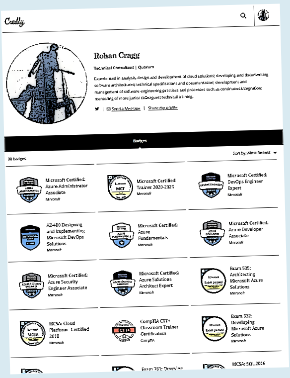

I'm Rohan, a software developer turned cloud architect based in Scotland. I work mostly with Azure, cloud and hybrid infrastructure, DevOps and security, with an increasing amount of AI, agents and developer tooling thrown into the mix.

This is my personal collection of technical notes, discoveries and things I'll otherwise forget and have to search for again.

## Fediverse

[Mastodon](https://mastodon.scot/@rohancragg){:rel="me"}

## Exams and Credentials

[My Credly Profile](https://www.credly.com/users/rohan-cragg/badges?sort=-state_updated_at&page=1){:target="_blank"}

{:target="_blank"}

## LinkedIn

<!-- markdownlint-disable-next-line MD033 -->

<a class="LI-simple-link" href='https://uk.linkedin.com/in/rohancragg?trk=profile-badge'>Rohan Cragg</a>

{:target="_blank"}

## StackExchange

{:target="_blank"}

## Work

{:target="_blank"}

I work as a Senior Consultant at [Quorum](https://www.quorum.co.uk/), a Microsoft-focused technology consultancy.

My work is varied, but tends to involve Azure and hybrid architecture, infrastructure as code, DevOps, integration and security. Increasingly, it also involves exploring AI, Microsoft Copilot and agent technologies, and working out how they can be used safely and usefully in enterprise environments.
