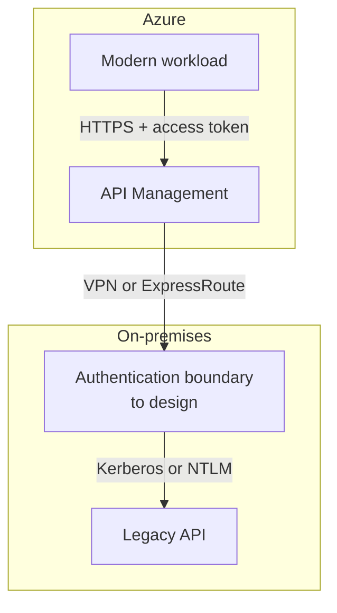
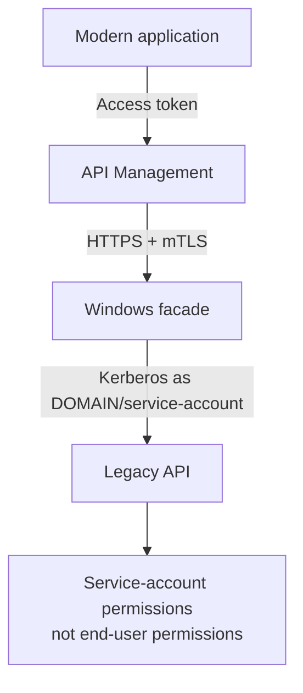
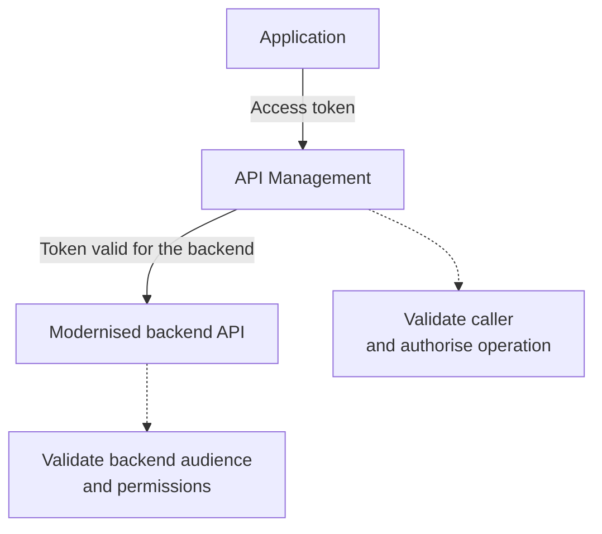
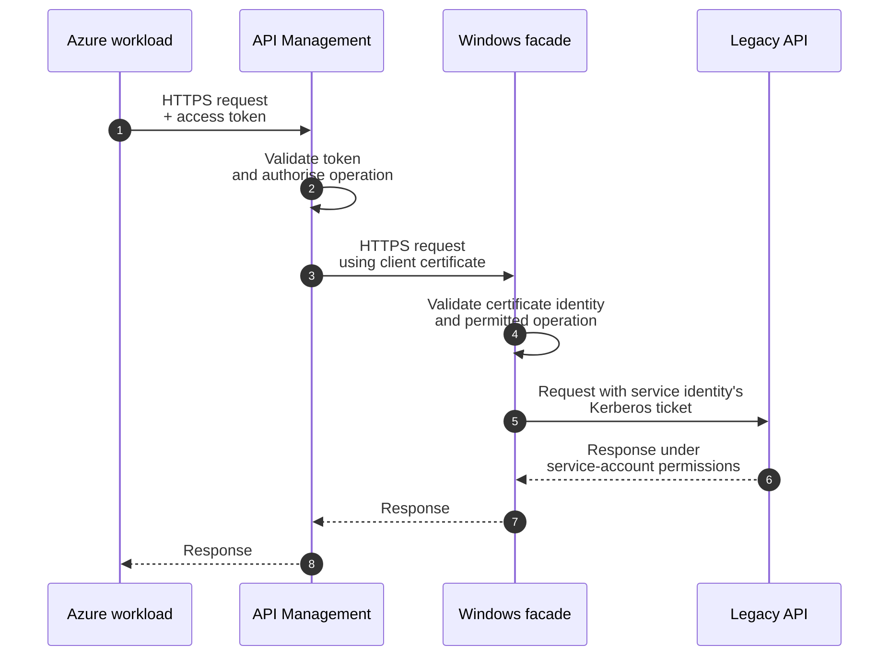
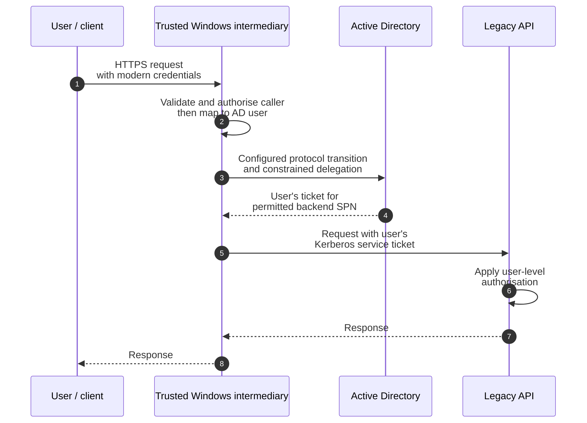
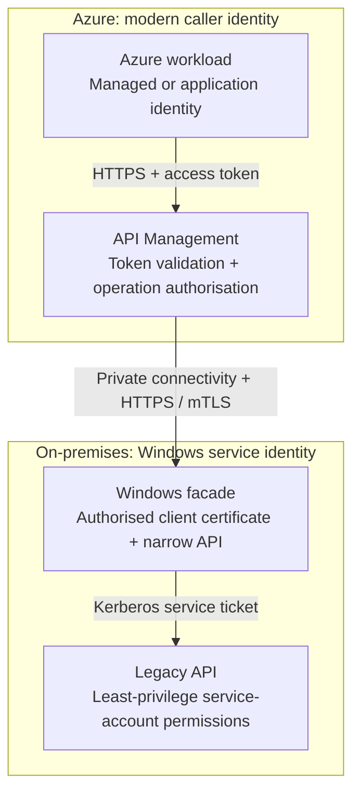

Modern Azure applications commonly use Microsoft Entra ID to obtain OAuth 2.0 access tokens for calling APIs, while older on-premises applications may expect Kerberos or NTLM.

Bridging the two isn't simply a networking problem. Even after Azure can reach the on-premises service over VPN or ExpressRoute, the caller still needs an identity that the legacy service understands.

!!! note "About this article"
      This is my personal blog content, not a Quorum case study. It grew out of a question a client posed to us during discussions about prospective work involving proxying between cloud and on-premises services. It documents the analysis we carried out before proposing a solution that was subsequently implemented successfully for that client. The patterns and recommendations described here do not necessarily represent the specific solution delivered to them.

A typical scenario looks like this:



The key question is:

> **Whose Windows identity does the legacy application actually need?**

## Service identity or user identity?

For many machine-to-machine integrations, the backend doesn't need to know which individual user initiated the request. It only needs to know that the request came from an authorised application.

In this case, an intermediary can call the legacy API using a dedicated Active Directory service identity:



This is usually much simpler than trying to propagate the user's identity through the entire chain.

If the legacy application performs authorisation as the original user, however, a service identity isn't equivalent. That's where Kerberos delegation may be required.

## Why can't API Management translate the identity?

An OAuth access token and a Kerberos ticket are fundamentally different credentials.

A Microsoft Entra access token contains claims about an identity and is issued for a particular audience. A Kerberos service ticket is issued by Active Directory for a particular service, identified through a Service Principal Name (SPN).

API Management doesn't provide a built-in OAuth-to-Kerberos token-conversion policy. A deliberately configured intermediary can bridge the two security models, but that requires its own identity, trust configuration and, for user impersonation, identity mapping and delegation permissions.

This distinction also matters when considering the [Azure API Management self-hosted gateway](https://learn.microsoft.com/azure/api-management/self-hosted-gateway-overview). Running the gateway on-premises can bring API policy enforcement closer to the backend, but it doesn't automatically give the gateway a Windows identity or enable it to impersonate a user.

## Option 1: Modernise the backend

The cleanest solution is to make the legacy API accept modern authentication directly:



This removes the authentication-translation problem and allows modern application or managed identities to be used end to end.

That doesn't necessarily mean forwarding the same token through every hop. Each receiving API must validate the intended audience and permissions. Depending on the design, API Management can forward a suitable caller token or obtain a backend token using its own identity; those choices produce different authorisation contexts.

Unfortunately, these integration problems often exist precisely because upgrading or modifying the legacy application isn't practical.

## Option 2: Introduce a small Windows facade

For service-to-service integration, a pragmatic alternative is a small Windows-hosted facade:

<!-- markdownlint-disable-next-line MD033 -->
<div style="overflow-x: auto;" markdown>



</div>

The facade provides a deliberate boundary between the modern and legacy security models.

It can:

- expose a small modern API;
- accept calls only from the trusted API layer;
- run under a dedicated, least-privilege domain identity;
- authenticate to the legacy service using Kerberos;
- translate between modern and legacy API contracts; and
- provide logging and auditing around the transition.

### Keep authentication and authorisation separate

mTLS authenticates the connecting API layer to the facade. It doesn't establish the original user's Windows identity, and it doesn't prove that every caller admitted by API Management may perform every backend operation.

For this pattern to be safe:

- API Management must validate the access token's signature, issuer, audience and lifetime, then enforce the required application roles or delegated scopes for each operation.
- The facade must validate the authorised client-certificate identity, not merely accept any certificate from a trusted issuer. Validate the server certificate on the APIM-to-facade connection too; don't disable TLS checks to make the connection work.
- Restrict network access to the intended API layer and close alternative routes that could bypass those checks. Private connectivity alone isn't authentication.
- Expose a narrow set of operations and fixed backend destinations, rather than a general-purpose proxy that can use the service identity against arbitrary URLs.
- Give the domain service identity only the backend permissions it needs. Where supported, consider a group Managed Service Account (gMSA), and protect any credentials the design still requires.
- Plan certificate rotation and expiry monitoring. Log the verified modern caller and the effective Windows identity for correlation, without logging access tokens, tickets or credentials.

Microsoft describes the separation between caller validation and backend authentication in its [API Management authentication and authorisation guidance](https://learn.microsoft.com/azure/api-management/authentication-authorization-overview).

The important architectural benefit is that **the legacy authentication mechanism doesn't leak into the modern application**.

The facade can eventually be removed when the legacy system is modernised or replaced.

### What if the backend supports only NTLM?

The Kerberos examples in this article assume the backend actually supports Kerberos. Integrated Windows Authentication and the `Negotiate` scheme shouldn't be treated as proof that Kerberos was used: negotiation can fall back to NTLM.

An NTLM-only backend needs separate assessment. A Windows facade may be able to authenticate using its own service identity if its HTTP client and the backend support NTLM, but this isn't the Kerberos flow shown above. NTLM also has connection-oriented authentication behaviour that affects proxying and connection reuse.

KCD obtains Kerberos tickets for the backend; it doesn't turn an NTLM-only backend into a Kerberos service or automatically preserve the original user's identity through NTLM. Prefer enabling Kerberos or modernising authentication where possible, and verify the protocol actually negotiated rather than relying on a successful response alone.

## Option 3: Use Kerberos Constrained Delegation

Things become more complicated if the backend genuinely needs the original user's Windows identity.

[Kerberos Constrained Delegation](https://learn.microsoft.com/windows-server/security/kerberos/kerberos-constrained-delegation-overview) allows a trusted service to act on behalf of a user when accessing explicitly permitted backend services.

Conceptually:

<!-- markdownlint-disable-next-line MD033 -->
<div style="overflow-x: auto;" markdown>



</div>

This is a conceptual flow, not an automatic token exchange. When the incoming authentication isn't Kerberos, the intermediary needs a supported protocol-transition design, commonly using the Kerberos Service for User (S4U) extensions, as well as permission to delegate to the specific backend service.

The design also needs:

- a securely validated modern identity mapped to the correct user account in on-premises Active Directory; an Entra-only account without a corresponding AD identity isn't enough;
- a domain identity for the intermediary, appropriate domain trust and connectivity to domain controllers;
- correct backend SPNs and narrowly scoped classic or resource-based constrained delegation, as appropriate to the environment;
- confirmation that the relevant user accounts are eligible for delegation; protected accounts or accounts marked as non-delegable can prevent the flow; and
- a Kerberos-capable backend that applies authorisation to the delegated user.

Never let an untrusted request header choose an arbitrary Windows username for impersonation. The identity used for delegation must come from the validated authentication context and an explicitly controlled mapping.

Microsoft's [Application Proxy KCD configuration guidance](https://learn.microsoft.com/entra/identity/app-proxy/how-to-configure-sso-with-kcd) provides a concrete example of these prerequisites and the cloud-to-AD identity mapping.

This can preserve user-level authorisation, but it introduces additional complexity around:

- SPNs;
- service identities;
- delegation permissions;
- Active Directory domains;
- DNS; and
- the trust placed in the intermediary.

It's therefore worth asking whether the legacy application really needs the user's Windows identity before introducing delegation.

## Don't forget SPNs

Kerberos identifies network services using **Service Principal Names**.

For an HTTP API, an SPN might look like this:

```text
HTTP/api.internal.example
```

The hostname used by the client, the DNS configuration, the SPN and the account running the service all need to agree.

Some useful diagnostic commands are:

```powershell
setspn.exe -Q HTTP/api.internal.example
setspn.exe -L DOMAIN\ServiceAccount
```

Incorrect or duplicate SPNs are a common cause of Kerberos authentication failures. They can also result in unexpected NTLM fallback, which may make the integration appear to work while preventing delegation.

## What about Microsoft Entra Application Proxy?

For interactive access to an on-premises web application, [Microsoft Entra Application Proxy](https://learn.microsoft.com/entra/identity/app-proxy/) is worth considering.

It can authenticate a user with Microsoft Entra ID and use Kerberos Constrained Delegation through an on-premises private network connector to provide single sign-on to an application that uses Integrated Windows Authentication and supports Kerberos.

The connector needs the appropriate AD delegation permissions, backend SPN and user identity mapping. This is a supported authentication bridge with specific prerequisites, not a feature obtained merely by placing a proxy on the network.

It's less obviously the answer for machine-to-machine API integration, where API Management and a narrowly scoped facade may provide a clearer separation of responsibilities. Assess the supported client and authentication flow rather than assuming an interactive SSO design also covers app-only access.

## My preferred pattern

For a machine-to-machine integration where the backend doesn't genuinely require end-user impersonation, I'd favour:



Each component then has a clear responsibility.

### Azure workload

Uses modern identity and knows nothing about Kerberos.

### Azure API Management

Authenticates and authorises the modern caller and provides the API boundary.

### Windows facade

Enforces the trusted inbound connection and permitted operations, translates API contracts, and calls the backend using the dedicated Windows service identity. It doesn't impersonate an end user in this pattern.

### Legacy API

Continues using its existing authentication model until it can be modernised or replaced.

## Conclusion

Connecting Azure to an older Windows-authenticated API isn't really about finding a clever way to make API Management speak Kerberos.

The more useful question is:

> **Where should the boundary between modern and legacy authentication live?**

Where possible, modernise the backend and remove the boundary altogether.

Where that isn't practical, a small Windows-hosted facade using a dedicated service identity provides a relatively simple transition pattern. Introduce user impersonation and Kerberos Constrained Delegation only where the backend genuinely requires the original user's Windows identity.

Most importantly, keep the workaround at the edge of the legacy system rather than allowing its authentication model to spread into the modern architecture.

## Further reading

- [Microsoft Entra identity platform](https://learn.microsoft.com/entra/identity-platform/)
- [API Management authentication and authorisation](https://learn.microsoft.com/azure/api-management/authentication-authorization-overview)
- [API Management backend client-certificate authentication](https://learn.microsoft.com/azure/api-management/authentication-certificate-policy)
- [API Management self-hosted gateway](https://learn.microsoft.com/azure/api-management/self-hosted-gateway-overview)
- [Kerberos Constrained Delegation overview](https://learn.microsoft.com/windows-server/security/kerberos/kerberos-constrained-delegation-overview)
- [Microsoft Entra Application Proxy](https://learn.microsoft.com/entra/identity/app-proxy/)
- [Application Proxy KCD prerequisites and configuration](https://learn.microsoft.com/entra/identity/app-proxy/how-to-configure-sso-with-kcd)
- [Windows authentication with KCD and Microsoft Entra ID](https://learn.microsoft.com/entra/architecture/auth-kcd)
