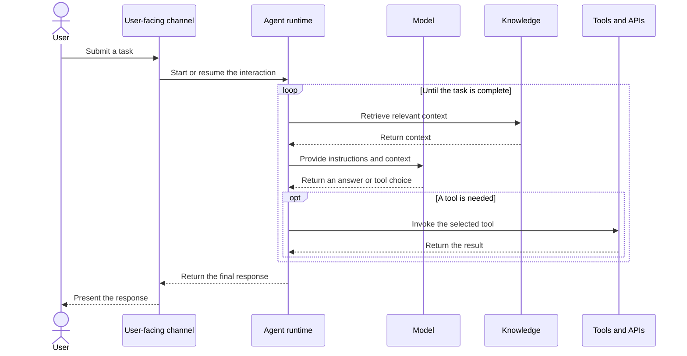
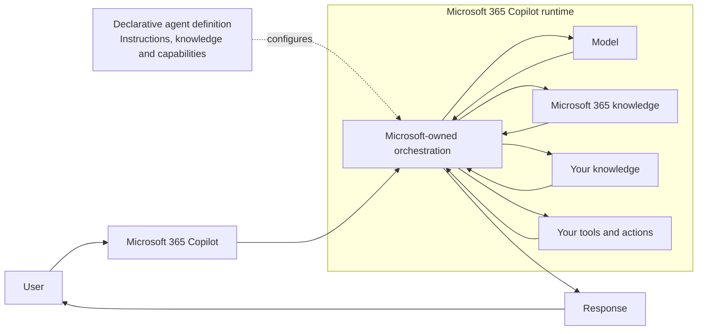
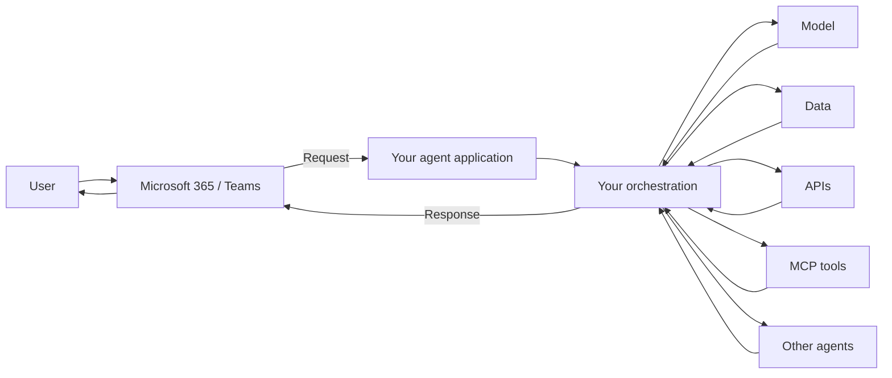
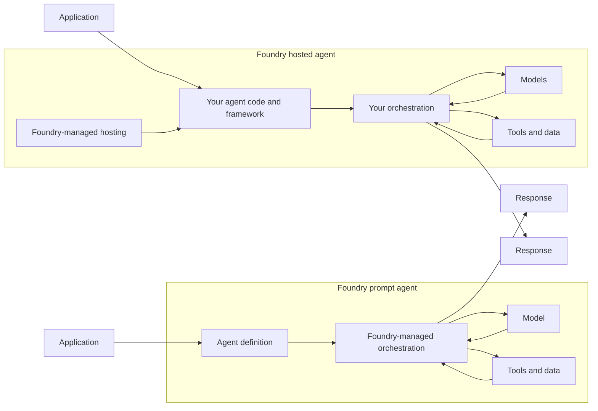
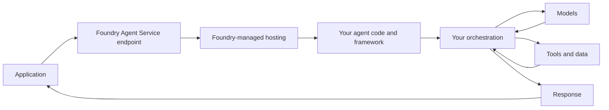
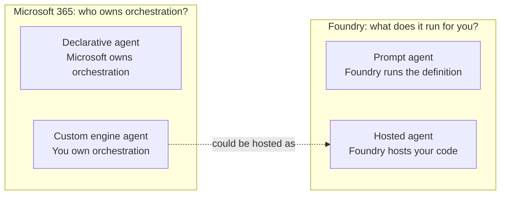
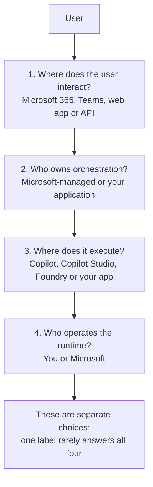
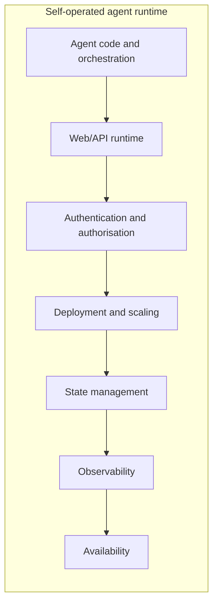
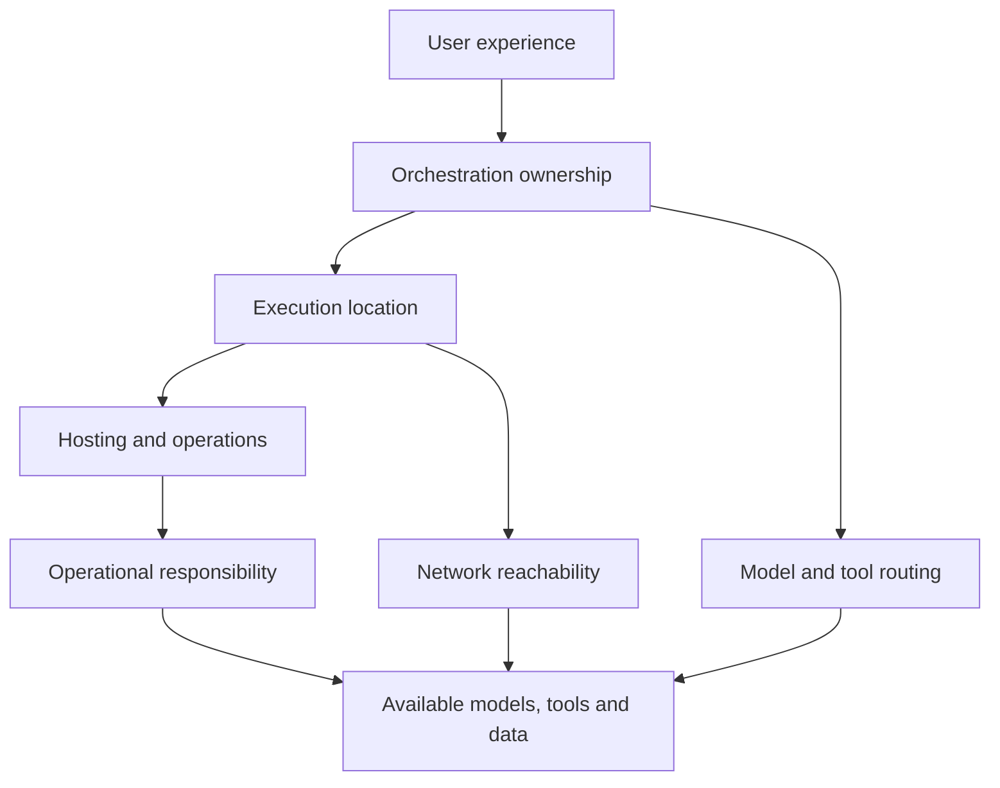

# Declarative, Custom Engine, Prompt and Hosted Agents: Making Sense of Microsoft's Agent Landscape

> **Valid as of October 2026**
>
> Microsoft's agent platform is evolving quickly, so terminology and product boundaries will continue to change. For current guidance on which Microsoft 365 development tools and authoring experiences to use, see Microsoft's [Choose development tools for your plugin](https://learn.microsoft.com/microsoft-365/copilot/extensibility/choose-plugin-development-tools) guidance.

One of the confusing things about Microsoft's rapidly evolving AI platform is the number of things called an *agent*.

Depending on which part of the Microsoft ecosystem you're looking at, you'll encounter:

- declarative agents;
- custom engine agents;
- prompt agents;
- hosted agents;
- Copilot Studio agents;
- agents built with the Microsoft 365 Agents SDK or Agent Framework; and
- agents built elsewhere but surfaced through Microsoft 365 Copilot or Teams.

These terms aren't necessarily competing definitions.

Some describe **how an agent is orchestrated**. Others describe **where an agent runs** or **how it is presented to users**.

That distinction makes the landscape considerably easier to understand.

## Start with orchestration

The first question I find useful is:

> **Who owns the agent loop?**

By *agent loop*, I mean the process that decides things such as:

1. which model to call;
2. what context to provide;
3. whether a tool needs to be invoked;
4. what to do with its result;
5. whether another tool or model call is required; and
6. when the task is complete.

At a very simplified level, the agent loop looks like this:

Something has to own that orchestration.

The biggest architectural distinction is whether **Microsoft owns it or you do**.

## Declarative agents: describe what you want

A [Microsoft 365 declarative agent](https://learn.microsoft.com/microsoft-365/copilot/extensibility/overview-declarative-agent) is essentially configuration that specialises the existing Microsoft 365 Copilot runtime.

You define things such as:

- purpose;
- instructions;
- knowledge;
- capabilities;
- actions and tools; and
- conversation starters.

But Microsoft 365 Copilot remains responsible for the underlying orchestration and models.

Conceptually, Microsoft 365 Copilot keeps control of the orchestration loop:

That's why *declarative* is a useful description.

You're describing the behaviour and resources available to an existing runtime rather than writing the runtime yourself.

This can be surprisingly powerful. A declarative agent can have quite specialised instructions, knowledge and tools without requiring you to build an agent application.

## Custom engine agents: you own the orchestration

A [custom engine agent](https://learn.microsoft.com/microsoft-365/copilot/extensibility/overview-custom-engine-agent) moves that boundary.

Instead of asking Microsoft 365 Copilot to orchestrate the agent for you, **your agent application owns its orchestration**.

Conceptually, Microsoft 365 or Teams provides the interaction surface while your application owns the loop:

Microsoft 365 might still provide the place where the user interacts with the agent, but that doesn't mean Microsoft 365 Copilot is running the agent's reasoning loop.

This distinction matters when you need control over:

- model selection;
- orchestration logic;
- complex multi-step workflows;
- custom state;
- model/tool routing;
- integration patterns; or
- the infrastructure executing the agent.

A useful simplification is therefore:

> **Declarative agent: configure Microsoft's engine.**
>
> **Custom engine agent: bring your own engine.**

Like most simplifications, there are details underneath it, but it's a useful starting point.

## Then Microsoft Foundry introduces another axis

[Microsoft Foundry Agent Service](https://learn.microsoft.com/azure/foundry/agents/overview) uses another pair of terms:

- **prompt agents**; and
- **hosted agents**.

These aren't simply alternative names for Microsoft 365 declarative and custom engine agents.

They're describing something slightly different.

The useful question here is:

> **What is Foundry actually running for me?**

## Foundry prompt agents

A Foundry **prompt agent** is declaratively defined.

You configure its:

- model;
- instructions;
- tools; and
- behaviour.

Foundry then runs it for you.

The difference is easier to see side by side:

That makes the concept similar in spirit to a Microsoft 365 declarative agent: you describe the agent rather than implement its orchestration loop.

But the host and surrounding platform are different.

A Microsoft 365 declarative agent specialises **Microsoft 365 Copilot**.

A Foundry prompt agent is an agent definition executed by **Foundry Agent Service**.

That distinction matters.

## Foundry hosted agents

A Foundry **hosted agent** moves the boundary further towards you.

You bring your own agent code and framework, package it for Foundry, and Foundry provides managed hosting around it.

The request flows through Foundry's managed hosting, while your code controls orchestration:

Foundry takes care of platform concerns such as the endpoint, compute, identity, scaling, session persistence and observability.

You own the code performing the orchestration.

This means a hosted agent can use Microsoft Agent Framework, another agent framework or custom code while still benefiting from Foundry's managed runtime infrastructure.

So:

> **Prompt agent: Foundry runs your agent definition.**
>
> **Hosted agent: Foundry runs your agent application.**

That's a subtle but important difference.

## The two sets of terminology describe different boundaries

This is the part that helped the terminology click for me.

The two vocabularies describe different boundaries:

These categories can therefore overlap.

For example, a custom engine agent surfaced through Microsoft 365 could be backed by an agent running in Microsoft Foundry.

From the Microsoft 365 perspective it's a **custom engine agent**, because Microsoft 365 Copilot doesn't own its orchestration.

From the Foundry perspective it could be a **hosted agent**, because Foundry hosts the custom orchestration code.

That's not contradictory. The two terms are describing different parts of the architecture.

## And then there's Copilot Studio

[Microsoft Copilot Studio](https://learn.microsoft.com/microsoft-copilot-studio/) adds another potential source of confusion because it's principally an **authoring and managed agent platform**, rather than simply another mutually exclusive agent type.

It can provide managed orchestration, knowledge, tools, connectors, workflows, governance and publishing into Microsoft channels.

So I wouldn't try to position "Copilot Studio agent" alongside declarative, custom engine, prompt and hosted as though they were four equivalent architectural choices.

A better question is:

> **Which capabilities is Copilot Studio providing in this particular solution?**

That might include authoring, orchestration, integration, hosting, governance or publishing.

## Development tools are another separate choice

Likewise, tools such as:

- Agent Builder;
- Work IQ Dev Tools;
- Microsoft 365 Agents Toolkit;
- Microsoft 365 Agents SDK;
- Microsoft Agent Framework; and
- GitHub Copilot

shouldn't be confused with the architecture itself.

They're ways of **authoring, implementing, packaging or assisting with** different parts of the solution.

Microsoft already maintains detailed guidance covering which development tool is appropriate for which Microsoft 365 scenario:

[Choose development tools for your plugin](https://learn.microsoft.com/microsoft-365/copilot/extensibility/choose-plugin-development-tools)

Rather than reproduce that matrix here, I think it's more useful to establish the architectural decision first and then use Microsoft's current guidance to choose the tooling.

## A mental model

Instead of asking:

> Which kind of Microsoft agent should I use?

I now try to answer four questions.

## A few examples

### A specialist Microsoft 365 assistant

I want an HR assistant grounded in approved Microsoft 365 content with a small number of well-defined actions.

I don't need to invent my own orchestration engine.

A **declarative agent** is a natural place to start.

### A bespoke multi-agent workflow

I need custom reasoning, specialised models, non-trivial state and explicit control over how several agents and tools collaborate.

I probably need a **custom engine agent**.

I might then choose to host that implementation using a **Foundry hosted agent**.

Those two labels describe different aspects of the same solution.

### An Azure application that needs an agent

I need an application-specific agent with instructions, a model and some tools, but I don't particularly want to own an orchestration runtime.

A **Foundry prompt agent** may be sufficient.

There's no requirement for Microsoft 365 Copilot to be involved at all.

### An existing agent brought into Microsoft 365

I already have an agent with its own orchestration and models.

If I surface that agent through Microsoft 365, I haven't magically turned it into a declarative agent.

From the Microsoft 365 perspective, this is a **custom engine** scenario because the orchestration remains external.

## The terminology matters less than the boundaries

The Microsoft agent landscape is going to continue changing.

New authoring experiences, SDKs, protocols and agent types will appear, and some of today's terminology will undoubtedly evolve.

The architecture is more durable.

Rather than starting by choosing an agent technology, it's more useful to start with four questions:

- **Do we want Microsoft to manage the orchestration, or do we need to control it?**
- **Where do we want that orchestration to execute?**
- **Do we want Microsoft to host the runtime, or do we need to operate it ourselves?**
- **Where do we want users to interact with the agent?**

The answers help us narrow down which of Microsoft's agent approaches actually fits the architecture.

Once those boundaries are clear, terms such as *declarative*, *custom engine*, *prompt* and *hosted* become considerably less mysterious.

And when Microsoft introduces another type of agent, hopefully we can work out where it fits without having to redraw the entire mental model.

So, in more detail:

Rather than starting by choosing an agent technology, it's more useful to start with four architectural questions.

### 1. Who do we want to own the orchestration?

At one end of the spectrum we can let Microsoft manage the orchestration. At the other, we can implement and control the agent loop ourselves.

Microsoft-managed orchestration is attractive when we want to concentrate on the agent's purpose, instructions, knowledge and tools rather than building the runtime that coordinates them.

Owning the orchestration becomes more attractive when we need things such as:

- explicit control over multi-step workflows;
- routing different tasks to different models;
- multiple reasoning or tool-calling loops;
- deterministic code mixed with model-driven decisions;
- specialised state or memory handling;
- custom error and retry behaviour;
- complex coordination between agents;
- complete control over the generated response; or
- portability beyond a single Copilot experience.

The trade-off is straightforward: **more control generally means more software for us to build, test, secure, observe and operate.**

So the question isn't whether owning the orchestration is inherently better. It's whether the solution needs enough control to justify owning it.

### 2. Where do we want the orchestration to execute?

This is related to orchestration ownership, but isn't quite the same question.

Execution could happen within:

- Microsoft 365 Copilot;
- Copilot Studio;
- Microsoft Foundry;
- our own Azure application; or
- another platform entirely.

Factors influencing this decision include:

- where the data and APIs the agent needs to access are located;
- private networking requirements;
- latency;
- data residency and compliance requirements;
- integration with Microsoft 365;
- existing Azure architecture;
- required models and tools; and
- how much control we need over the runtime environment.

This becomes particularly important when private resources are involved. An agent's ability to use a tool ultimately depends on whether the component making the call can actually reach it.

#### When private access influences the decision

Networking can also influence where we choose to run the orchestration.

For example, an agent might need to access:

- an API exposed only through an Azure private endpoint;
- an internal API reachable through a VNet or ExpressRoute;
- private Azure AI Search, Storage or database resources;
- an MCP server deliberately exposed only inside our network; or
- on-premises systems available only through private connectivity.

A Microsoft 365 declarative agent runs within Microsoft 365 Copilot rather than inside our Azure VNet, so we can't assume that making a resource private also makes it reachable by the agent.

Copilot Studio provides additional options through Power Platform Virtual Network support, which can provide private connectivity for supported resources and integration scenarios.

Where we need greater control over the agent runtime's connectivity to private Azure and on-premises resources, **Microsoft Foundry Agent Service** can become an attractive option. Foundry agents can be integrated with a customer VNet and access resources through private endpoints while still being surfaced to users through experiences such as Microsoft 365 Copilot or Teams.

The important architectural point is that:

> **Where users interact with an agent doesn't have to be where its orchestration executes.**

This means we should include another question when deciding where our orchestration belongs:

> **Can the runtime we're considering reach every tool and data source the agent needs, using the network controls we require?**

The details quickly become more nuanced, particularly when a privately networked agent also needs to be invoked from a SaaS service such as Microsoft 365 Copilot or Teams. I've explored that separately in [Private Networking Changes Your AI-Agent Architecture](private-networking-changes-your-ai-agent-architecture.md), including inbound versus outbound connectivity, private endpoints, identity and the situations where tightly controlled public ingress may still be required.

### 3. Who do we want to host and operate the runtime?

Even if we own the agent's orchestration code, we don't necessarily have to own all of the infrastructure underneath it.

For example, a **Foundry Hosted Agent** lets us bring our own agent code and orchestration while Microsoft manages much of the surrounding runtime, including the endpoint, identity, scaling, session state and lifecycle.

That can be a useful middle ground: **we own what the agent does, while Microsoft operates where it runs**.

There are, however, situations where we might deliberately choose to host and operate the runtime ourselves.

For example:

- **The agent is part of an existing application.**
  If we already have an API or application platform running in App Service, AKS or another environment, embedding the agent runtime there may be simpler than introducing a separate managed agent host.

- **We need complete control over networking.**
  We might need specific routing, firewall, proxy, DNS or hybrid-network behaviour that is easier to implement when the runtime is part of infrastructure we already control.

- **We need specialised compute or runtime dependencies.**
  The agent might depend on particular libraries, operating-system features, local services, hardware or execution characteristics that aren't provided by the managed runtime.

- **We need to control scaling and deployment ourselves.**
  Existing platform standards might require our own deployment strategies, autoscaling rules, availability model, release process or disaster-recovery architecture.

- **The agent needs to share application state or services.**
  If the agent is tightly coupled to an existing application's cache, message bus, database, background workers or other internal components, putting it into the same runtime boundary may simplify the architecture.

- **We need custom request handling or protocols.**
  The agent might be part of a broader API that has requirements beyond conversational requests, or needs to participate in an existing application protocol and security model.

- **We need portability between platforms.**
  Operating the runtime ourselves can reduce dependency on the lifecycle and constraints of a particular managed agent-hosting service.

- **Our operational or compliance requirements demand it.**
  Sometimes the organisation needs direct control over patching, logging, monitoring, data handling, runtime configuration or the infrastructure on which particular workloads execute.

The trade-off is that we then become responsible for more of the platform:

This is why owning the orchestration doesn't automatically mean we should operate the runtime ourselves.

For example, if we need our own orchestration code but don't have any unusual infrastructure requirements, a Foundry Hosted Agent can let us keep control over the code while offloading endpoint management, identity, scaling, session persistence and lifecycle management to Microsoft.

Conversely, if the agent is already a natural part of an application platform we operate, introducing a separate managed agent runtime simply to avoid hosting it ourselves may add another boundary rather than remove complexity.

So the more useful question is:

> **Does operating the runtime ourselves give us an architectural capability we actually need, or just additional infrastructure to manage?**

This is another trade-off rather than a maturity ladder. Managed hosting isn't inherently less sophisticated, and self-hosting isn't inherently more capable. The right boundary depends on how much control the solution actually requires.

### 4. Where do we want users to interact with the agent?

The agent's runtime and its user experience don't necessarily have to live in the same place.

Users might interact with an agent through:

- Microsoft 365 Copilot;
- Teams;
- a web application;
- a mobile application;
- an existing line-of-business system; or
- an API used by another application or agent.

Microsoft 365 and Teams can be compelling when the agent is intended to appear where users already work and needs access to Microsoft 365 context.

A custom application may make more sense when we need:

- a highly specialised user experience;
- tight integration with an existing application;
- interaction patterns that don't fit conversational UI;
- support for users outside Microsoft 365; or
- complete control over presentation and interaction.

Importantly, **the place where the user interacts with an agent doesn't necessarily tell us where that agent is running**.

A custom engine agent can, for example, appear inside a Microsoft 365 experience while its orchestration executes elsewhere.

## The decisions influence one another

These four questions aren't completely independent:

A requirement in one area can constrain the options elsewhere.

For example, private networking might influence where the agent needs to execute. A requirement to route between specialised models might push us towards owning the orchestration. A desire to minimise operational responsibility might push us towards a managed runtime.

So rather than starting with:

> "Should we build a declarative agent, custom engine agent, prompt agent or hosted agent?"

we can start with:

> **What capabilities and boundaries does the solution actually need?**

Once we've made those architectural decisions, Microsoft's different agent models become ways of implementing them rather than choices we have to make before understanding the problem.

## Further reading

- [Choose development tools for your plugin](https://learn.microsoft.com/microsoft-365/copilot/extensibility/choose-plugin-development-tools)
- [Compare declarative and custom engine agents](https://learn.microsoft.com/microsoft-365/copilot/extensibility/agents-overview)
- [Declarative agents for Microsoft 365 Copilot](https://learn.microsoft.com/microsoft-365/copilot/extensibility/overview-declarative-agent)
- [Custom engine agents for Microsoft 365](https://learn.microsoft.com/microsoft-365/copilot/extensibility/overview-custom-engine-agent)
- [Microsoft Foundry Agent Service](https://learn.microsoft.com/azure/foundry/agents/overview)
- [Hosted agents in Foundry Agent Service](https://learn.microsoft.com/azure/foundry/agents/concepts/hosted-agents)
