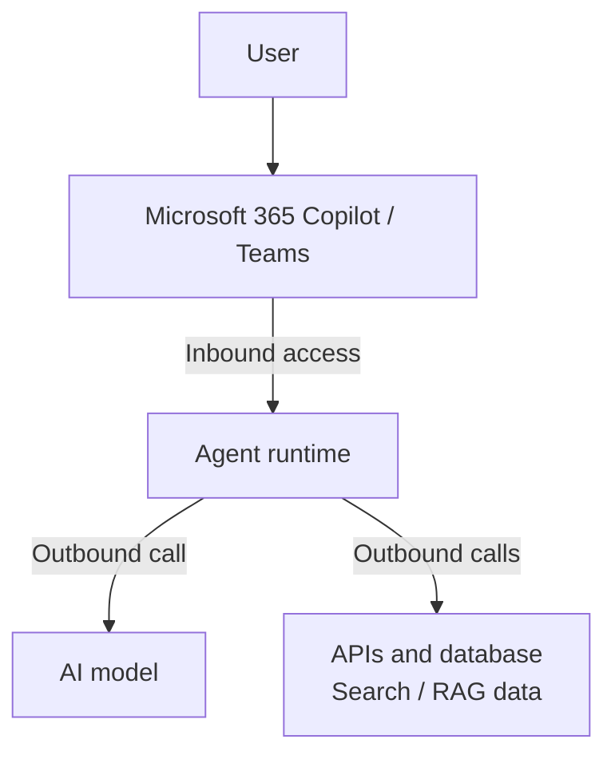
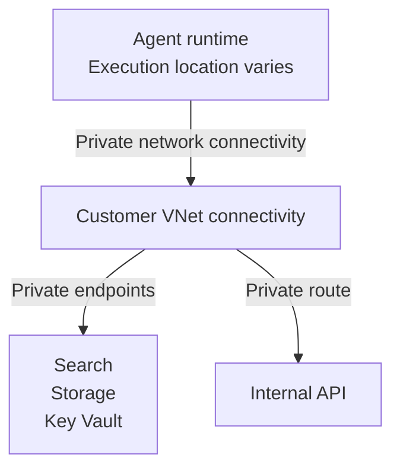
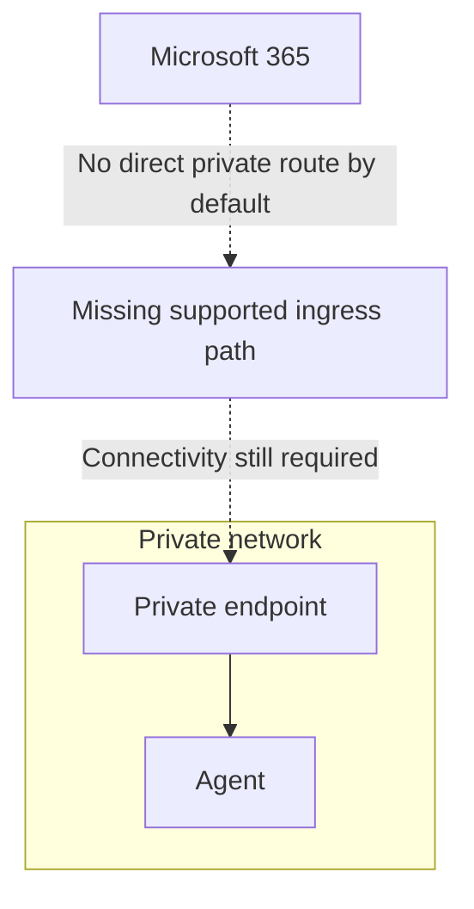
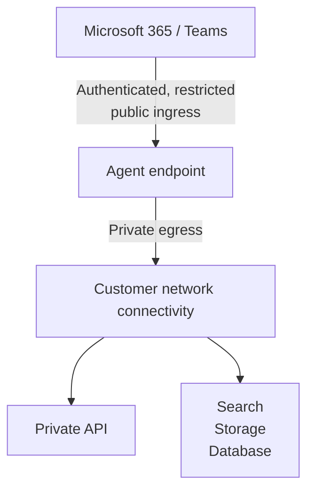
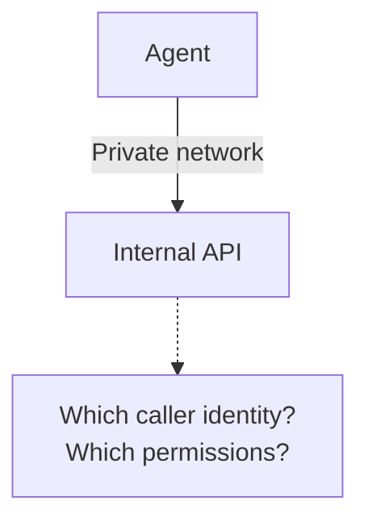
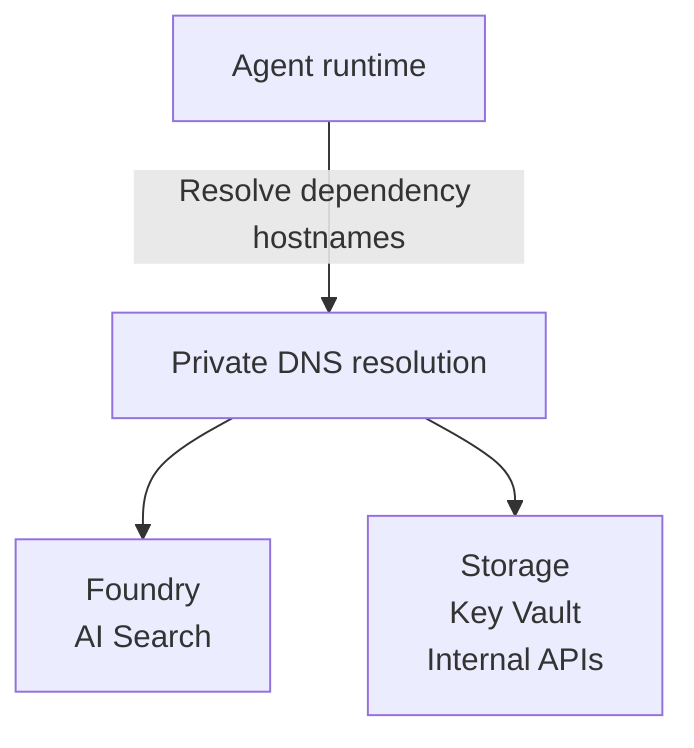
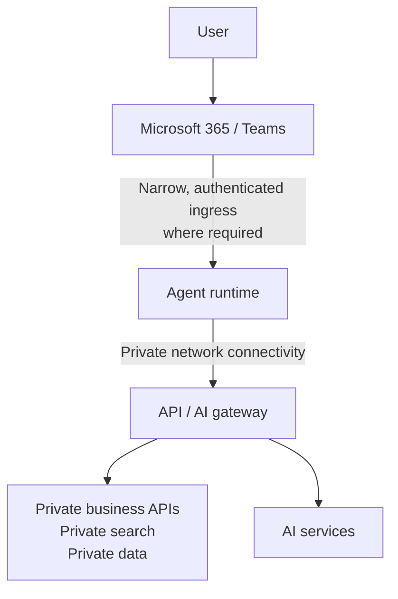
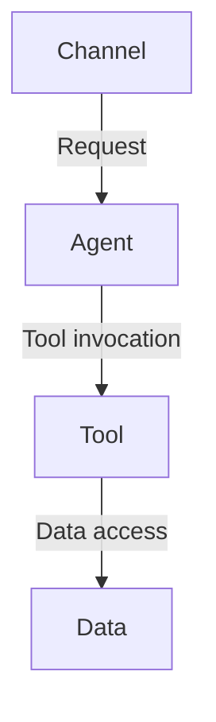

It's tempting to think of private networking as something that can be added to an AI solution after its basic architecture has been decided:

1. Build the agent.
2. Add private endpoints.
3. Disable public network access.
4. Job done.

Unfortunately, agents make this rather more interesting.

An agent isn't simply an application calling a language model. It may be called from Microsoft 365 or Teams, call models and tools itself, retrieve information from private data sources, access APIs and maintain state.

Once those resources become private, **where each part of the agent executes and which component initiates each connection suddenly matters**.

!!! note "About this article"
      This is my personal blog content, not a Quorum case study. It grew out of an engagement where we augmented a client team implementing network isolation for AI agents. It documents the analysis we carried out before proposing a solution that was subsequently implemented successfully for that client. The patterns and recommendations described here are more generic and does not necessarily represent the specific solution delivered with that engagement.

## There are two directions to think about

Consider an agent that needs to access private organisational data:

There are actually two separate networking questions here:

1. **How does the user or channel reach the agent?**
2. **How does the agent reach its tools and data?**

Those paths don't necessarily have the same answer.

Microsoft Foundry's networking model makes a similar distinction between inbound access to Foundry and outbound access from agents to their dependencies.

[Microsoft Foundry network isolation](https://learn.microsoft.com/azure/foundry/how-to/configure-private-link)

## Making the data private is the easier direction

Suppose the agent needs to call:

- Azure AI Search;
- Azure Storage;
- Azure SQL;
- Key Vault;
- an internal API; or
- another private Azure service.

A network-secured Foundry environment can connect agent workloads to a customer VNet and use private endpoints to reach those resources.

Conceptually:

This provides a fairly familiar Azure architecture: private endpoints, DNS, subnets, routing and identity.

Foundry Agent Service supports private networking specifically for this purpose.

[Foundry Agent Service private networking](https://learn.microsoft.com/azure/foundry/agents/how-to/virtual-networks)

But there's an important subtlety here too: the agent's compute may not actually be running *inside* your VNet.

Foundry uses platform-managed components and brings the necessary connectivity into the customer network. The exact traffic path also differs between prompt agents and hosted agents.

[Foundry Agent Service networking deep dive](https://learn.microsoft.com/azure/foundry/agents/concepts/agents-networking-deep-dive)

So "the agent is in my VNet" can be a misleading mental model.

It's better to ask:

> **Which component is making this connection, and how does that component obtain private network connectivity?**

## The opposite direction is more interesting

Now consider an agent that users access from Microsoft 365 Copilot or Teams.

If the Foundry endpoint is accessible *only* through a private endpoint:

Microsoft 365 isn't sitting inside your VNet.

It also can't simply resolve and connect to your Azure private endpoint.

This means that "disable all public access" can conflict with the requirement to expose the agent through a SaaS channel.

Microsoft's current Foundry architecture handles this by allowing a tightly scoped public route for Microsoft 365 and Teams agent traffic even when public network access to the Foundry project is otherwise disabled.

[Publishing a private Foundry agent to Microsoft 365 and Teams](https://learn.microsoft.com/azure/foundry/agents/how-to/publish-copilot-virtual-network)

The important distinction is:

> **Publicly reachable doesn't have to mean publicly accessible.**

The endpoint can remain protected by authentication, authorisation and restrictions on which Microsoft service traffic can reach it while the rest of the Foundry environment remains private.

This produces an architecture more like:

That's quite different from simply putting everything behind private endpoints.

## Private networking therefore affects your choice of agent

This is one reason why choosing between a declarative agent, Copilot Studio agent and custom/Foundry-hosted agent isn't purely a development decision.

The execution location matters.

If Microsoft 365 is doing most of the orchestration, the networking characteristics are different from an architecture where your own agent runtime needs to call private resources.

Likewise, if an agent invokes an MCP server or other tool, you need to know **who actually makes that call**.

A useful question for every tool in an agent architecture is:

> **From where does this HTTP connection originate?**

Not:

> "Is this tool private?"

That simple question often reveals whether the proposed architecture will actually work.

## Copilot Studio has its own private networking model

Copilot Studio adds another variation.

Power Platform environments can use Virtual Network support to allow agents to communicate with supported Azure and private resources without exposing those resources to the public internet.

For example, this can be used for supported agent calls to resources such as Azure SQL, Key Vault and Application Insights.

[Copilot Studio Virtual Network support](https://learn.microsoft.com/microsoft-copilot-studio/admin-network-isolation-vnet)

Again, the important concept isn't that "Copilot Studio is inside the VNet".

Rather, Microsoft provides a controlled network path from the managed service into the private environment.

That distinction becomes important when deciding whether a particular connector, API or tool can actually be reached privately.

## Identity still matters

Private networking can reduce exposure, but it doesn't replace authentication.

An architecture such as:

should still answer:

> What identity is the agent presenting to the API?

Ideally the answer is something like a managed workload identity or OAuth access token rather than simply:

> It's on the private network.

The strongest designs generally combine:

- private connectivity;
- workload identity;
- least-privilege authorisation;
- API-level policy; and
- application-level validation.

Network location is one signal, not the identity model.

## Don't forget DNS

Private endpoints also bring one of Azure's less glamorous architectural concerns back into the picture: DNS.

An agent may have network connectivity to a private resource and still fail because the hostname resolves to its public address rather than the private endpoint.

For an agent that touches several services, you might need private DNS resolution for:

Centralised networking, VNet peering and custom DNS therefore become part of the AI architecture even though none of them have anything specifically to do with AI.

In many enterprise deployments, debugging an "AI problem" may eventually turn out to mean debugging DNS.

## A pattern I increasingly prefer

For enterprise agents handling sensitive data, the architecture I find easiest to reason about is:

### A concrete Azure ingress example

For a custom agent endpoint that we control, that narrow ingress could be implemented as `Client/channel -> WAF -> API Management -> agent runtime`:

- **Regional ingress:** [Azure Application Gateway using the WAF_v2 SKU in front of APIM](https://learn.microsoft.com/azure/api-management/api-management-howto-integrate-internal-vnet-appgateway).
- **Global ingress:** [Azure Front Door Premium with a WAF policy in front of APIM](https://learn.microsoft.com/azure/web-application-firewall/afds/protect-api-hosted-apim-by-waf). Premium supports managed WAF rules and [Private Link to supported APIM origins](https://learn.microsoft.com/azure/frontdoor/standard-premium/how-to-enable-private-link-apim), subject to the APIM tier and configuration.

`WAF_v2` is an Application Gateway SKU; Front Door uses its own WAF policies, not that SKU. The WAF filters malicious HTTP traffic, while APIM validates access tokens, enforces caller permissions, throttles requests and applies API policies. Configure the origin so callers cannot bypass this ingress path and reach APIM or the agent directly.

Here APIM governs calls *into* the agent; the outbound API / AI gateway in the diagram governs calls to models and tools. These patterns depend on compatible hosting, networking and channel support: they don't replace a managed service's prescribed Microsoft 365 / Teams publishing route.

The important property isn't that every line in the diagram is private.

It's that **each network boundary is deliberate**.

For each connection I want to know:

1. Who initiates it?
2. Where does it originate?
3. Is it public or private?
4. How is the caller authenticated?
5. What is it authorised to do?

If those questions can't be answered, drawing a private endpoint icon on the architecture diagram probably isn't enough.

## Conclusion

Private networking isn't a switch that can simply be turned on after designing an AI agent.

It can influence:

- which kind of agent you build;
- where execution occurs;
- how tools are invoked;
- whether SaaS channels can reach the agent;
- how the agent reaches private data;
- where API gateways belong;
- DNS and routing; and
- which identities are used between components.

The biggest lesson for me is to stop thinking of an agent as a single box.

Instead, trace every network call:

Then ask where each call originates and where it terminates.

Once you do that, it becomes much clearer where private endpoints are useful, where VNet integration is required, and where some carefully controlled public ingress may actually be an unavoidable part of the architecture.

**Private by design doesn't necessarily mean there are no public endpoints. It means that every exposed endpoint is intentional, authenticated, authorised and no more exposed than it needs to be.**

## Further reading

- [Configure network isolation for Microsoft Foundry](https://learn.microsoft.com/azure/foundry/how-to/configure-private-link)
- [Foundry Agent Service private networking](https://learn.microsoft.com/azure/foundry/agents/how-to/virtual-networks)
- [Foundry Agent Service networking options](https://learn.microsoft.com/azure/foundry/agents/concepts/networking-options)
- [Foundry Agent Service networking deep dive](https://learn.microsoft.com/azure/foundry/agents/concepts/agents-networking-deep-dive)
- [Publish a network-secured Foundry agent to Microsoft 365 and Teams](https://learn.microsoft.com/azure/foundry/agents/how-to/publish-copilot-virtual-network)
- [Copilot Studio Virtual Network support](https://learn.microsoft.com/microsoft-copilot-studio/admin-network-isolation-vnet)
